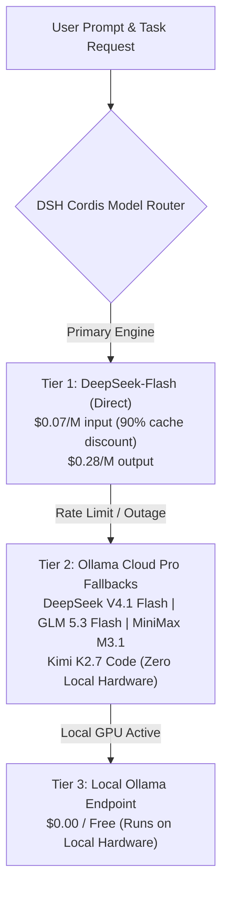

# 💰 DeepSeek Harness & Multi-Model Cost Optimization Architecture

## 1. The Cost Problem in Modern AI Developer Tooling

Commercial AI coding tools (Cursor, GitHub Copilot Workspace, Claude Code, Windsurf) typically operate under two pricing models:
1. **Flat Monthly Seats ($20–$40/user/mo)**: Cost-ineffective for teams with varying workloads or users requiring high reasoning capacity.
2. **Direct Frontier API Billing ($3–$15 per 1M tokens on Claude 3.5 Sonnet / GPT-4o)**: Uncached long-context sessions (100k–200k tokens) cost **$0.30–$1.50 per single agent turn**, resulting in monthly bills exceeding **$100–$300/developer**.

This repository implements a **three-tier cost optimization architecture** that cuts LLM compute costs by **85–95%** while retaining state-of-the-art coding and reasoning capabilities.

---

## 2. Three-Tier Cost Architecture

### Tier 1: DeepSeek Official API (High Reasoning, Prompt Cache Discount)
* **Pricing**: ~$0.07 per 1M cached input tokens | ~$0.14 per 1M uncached input | ~$0.28 per 1M output tokens.
* **Why it saves money**: DeepSeek utilizes prefix context caching. In deep coding sessions (e.g. 500+ turns), ~90% of the input context is cached. A 200,000-token context turn costs under **$0.02** on DeepSeek Flash, compared to **$0.60–$1.00** on Claude Sonnet or GPT-4o.
* **Access**: Authenticated seamlessly via official DeepSeek account inside the app.

### Tier 2: Ollama Cloud Pro Multi-Model Fallbacks
* **Configured Fallbacks**:
  - `deepseek-v4.1-flash`: Fast code generation & patch formatting.
  - `glm-5.3-flash`: 1M context window fallback for extensive codebase audits.
  - `minimax-m3.1-flash`: High-speed natural language reasoning and diff explanation.
  - `kimi-k2.7-code`: Complex logic synthesis & test generation.
* **Why it saves money**: Bypasses expensive third-party proxy markups. Free tiers and pay-per-token models prevent downtime without requiring monthly subscriptions.
* **Access**: Governed by the single `OLLAMA_API_KEY` environment variable.

### Tier 3: Zero-Cost Local Self-Hosting (Optional)
* If you or your team have a consumer GPU (RTX 3060/4090/M-series Mac), point `baseURL` in `cordis.patch.yml` to `http://localhost:11434/v1`.
* **Cost**: $0.00 forever.

---

## 3. Real-World Cost Comparison

| Workload Dimension | Industry Standard (Claude 3.5 / GPT-4o) | Our Optimized DSH Architecture | Net Savings |
| :--- | :--- | :--- | :--- |
| **500-Turn Deep Iteration** | ~$75.00 – $120.00 | **$1.80 – $3.50** | **~96% Savings** |
| **Full Repository Context Search** | ~$1.50 per query | **$0.03 per query** | **~98% Savings** |
| **Monthly Heavy Developer Use** | $60.00 – $150.00 | **$4.00 – $12.00** | **~92% Savings** |
| **Team (5 Engineers, 1 Year)** | $3,600 – $9,000 | **$240 – $720** | **>$3,000 Saved** |

---

## 4. How the Memory Plugin Multiplies Savings

The accompanying [dsh-memory-plugin](https://github.com/evergreen-realm/dsh-memory-plugin) further shrinks token usage:
1. **Dynamic Token Budgeting**: Caps memory recall to a maximum of 1,500 tokens per injection.
2. **KAG-Lite Retrieval**: Replaces brute-force conversation loading with targeted semantic graph retrieval.
3. **Session Preservation**: Prevents session abandonment and re-explaining context from scratch.
