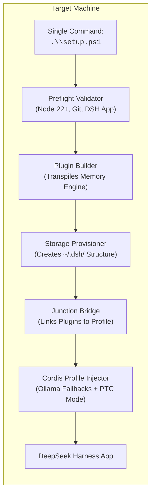

<div align="center">

# ⚡ DeepSeek Harness Starter Kit & Production Infrastructure
### Automated 1-Command Deployment, Multi-Model Failover Routing, and Update-Resilient Architecture for DeepSeek Harness (DSH)

[](setup.ps1)
[](https://nodejs.org/)
[](LICENSE)
[](COSTS.md)
[](https://github.com/evergreen-realm/dsh-memory-plugin)

<p align="center">
  <b>A reproducible, zero-configuration setup orchestrator that provisions DeepSeek Harness with an enterprise memory plugin, multi-model fallback mesh, and self-healing session repair.</b>
</p>

---

</div>

## 📌 Executive Summary

Setting up frontier AI coding environments across multiple machines is notoriously fragile. Default installations suffer from:
* **Fragile Scratch Paths**: Plugins linked to temporary directories break during workspace cleanup.
* **Update Erasure**: Automatic client updates (`%LOCALAPPDATA%\Programs\DeepSeek Harness`) wipe out customizations and custom node modules.
* **Session Deserialization Crashes**: Asynchronous context writes cause monotonic sequence mismatches (`SessionFormatError: system/message requires a protected first surface head`), locking developers out of hundred-turn sessions.
* **Single-Provider Bottlenecks**: Total dependency on one API leaves teams stalled during rate limits or outages.

**`dsh-harness-setup`** provides a turnkey, production-grade deployment script (`setup.ps1`) that completely automates installation, builds the zero-dependency memory plugin from source, configures cost-optimized multi-model fallbacks, and shields the environment from auto-update corruption.

---

## 🏗 What This Repository Implements



### 1. Single-Command Turnkey Deployment (`setup.ps1`)
Clones, verifies runtime prerequisites, compiles the `@evergreen-realm/dsh-memory-plugin` submodule, configures user profiles, and creates persistent NTFS junction links in under **60 seconds**.

### 2. Update-Proof Storage Topology
Separates the ephemeral application binaries from user state:
* **Ephemeral Application Layer** (`%LOCALAPPDATA%\Programs\DeepSeek Harness`): Replaced automatically during client updates without touching user configurations.
* **Persistent User Storage Layer** (`~/.dsh/`): Hosts plugins in `plugins-src/`, profile definitions in `profiles/desktop/`, and multi-frame zstd session logs in `sessions/` — guaranteeing **100% update survival**.

### 3. Integrated Session Format Healer (`dsh-session-sanitizer.py`)
Includes a standalone diagnosis and repair utility that audits session logs, reconciles monotonic sequence gaps, and converts illegal mid-session system events into harmless ignorable frames — salvaging broken sessions in seconds.

### 4. Enterprise Model Routing (`cordis.patch.yml`)
* **Primary**: Official DeepSeek Flash with deep reasoning and prompt caching.
* **Failover Matrix**: Ollama Cloud Pro multi-model routing across DeepSeek V4.1 Flash, GLM 5.3 Flash (1M context), MiniMax M3.1, and Kimi K2.7 Code.
* **Cost Impact**: Reduces operational LLM overhead by **85–95%** compared to commercial proprietary seats. (See [COSTS.md](COSTS.md)).

---

## ⚡ Quickstart (One Command)

Open **PowerShell** on any Windows 10/11 workstation and run:

```powershell
git clone --recurse-submodules https://github.com/evergreen-realm/dsh-harness-setup.git
cd dsh-harness-setup
.\setup.ps1
```

### Optional Command-Line Parameters:
```powershell
# Set up without automatically launching the app
.\setup.ps1 -SkipLaunch

# Provide Ollama Cloud API key programmatically
.\setup.ps1 -OllamaKey "your-api-key"
```

---

## 📁 Repository Structure

```
dsh-harness-setup/
├── plugins/
│   └── dsh-memory-plugin/     # Git Submodule -> evergreen-realm/dsh-memory-plugin
│
├── profile-templates/         # Reproducible profile templates
│   ├── package.json.template  # Dynamically resolves {{PLUGIN_PATH}} at setup
│   ├── cordis.yml             # Base empty profile specification
│   ├── cordis.patch.yml       # Model providers, fallbacks, PTC agent presets, & web tools
│   └── pnpm-workspace.yaml    # Workspace linker definition
│
├── scripts/
│   └── dsh-session-sanitizer.py # Standalone zstd multi-frame session log healer
│
├── setup.ps1                  # Primary Windows automation script
├── .env.example               # Template for optional API credentials
├── COSTS.md                   # In-depth LLM pricing and cost-reduction analysis
└── README.md
```

---

## 🛡 Security & Credential Isolation

* **No Credentials Stored**: This setup is completely credential-agnostic.
* **Keychain Storage**: DeepSeek user credentials are stored exclusively in the native OS Electron keychain on first login.
* **Environment Injection**: External API tokens (e.g. `OLLAMA_API_KEY`) are stored in User-level environment variables, never hardcoded in files.

---

## 🔧 Session Recovery Tooling

If DeepSeek Harness throws a session loading error:
```
SessionFormatError: system/message requires a protected first surface head
```

Run the built-in sanitizer:
```powershell
python ~/.dsh/scripts/dsh-session-sanitizer.py
```
To run in dry-run inspection mode:
```powershell
python ~/.dsh/scripts/dsh-session-sanitizer.py --check
```

---

## 📄 License

This setup framework is licensed under the [MIT License](LICENSE).
